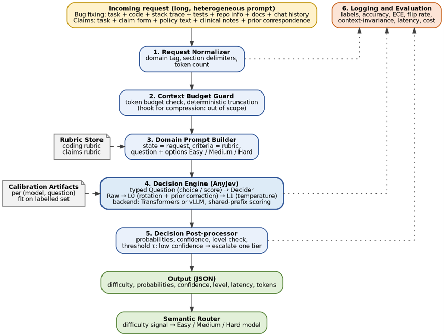

# Semantic Routing with LLM-Based Difficulty Classification using AnyJev

**Project ID**: 17
**Group ID**: 16  
**Group Members**: Venna Sai Venkata Manohar (`cs24mtech15012`)
**Course**: CS5903 — Distributed AI Training
**Submission Tag**: `cs5903-final-2026`  

---

## 1. Project Purpose & Current Status

In production LLM serving, routing every incoming request to a frontier model incurs high CostOps expense, while routing complex bugs to small models leads to test failures. 

This repository implements a **training-free, zero-generation semantic difficulty router** using [AnyJev](https://github.com/nokia-applied-research/AnyJev). Using an LLM (`Qwen/Qwen3-4B`), the router classifies task difficulty directly from next-token prefill logits across three ordinal tiers (`Easy`, `Medium`, `Hard`):
* **Easy (`<15m` fix)** $\longrightarrow$ Fast, cheap model tier.
* **Medium (`15m - 1h` fix)** $\longrightarrow$ Standard model tier.
* **Hard (`>1h` fix)** $\longrightarrow$ Frontier model tier.

### Current Implementation State
* **Delivered Pipeline**: End-to-end implementation complete (normalizer, context budget guard, domain prompt builder, AnyJev decision engine, and post-processor).
* **Evaluation**: Evaluated across all 500 instances of [SWE-bench Verified](https://huggingface.co/datasets/SWE-bench/SWE-bench_Verified) on a 40/20/40 train/dev/test split.

---

## 2. Architecture & Workflow

The router executes as an end-to-end, single-turn classification pipeline without autoregressive generation:



1. **Request Normalizer (`router/normalizer.py`)**: Parses heterogeneous requests into XML-delimited `<TASK>` and `<CONTEXT type="...">` blocks.
2. **Context Budget Guard (`router/budget.py`)**: Enforces a 12,000 token context budget ceiling. Auxiliary context (`issue_comments`, `docs`, `stack_trace`) is trimmed first; `<TASK>` is strictly protected.
3. **Domain Prompt Builder (`router/prompt.py`)**: Assembles task state with domain YAML rubrics (`rubrics/coding_bugfix.yaml` or `rubrics/insurance_claims.yaml`).
4. **AnyJev Decision Engine (`router/engine.py`)**: Computes prefill logits over candidate labels. At L0, it evaluates $K = 3$ cyclic option rotations to eliminate position/recency bias; at L1, it applies fitted temperature scaling.
5. **Decision Post-Processor (`router/postprocess.py`)**: Applies argmax selection and confidence-threshold escalation ($\tau = 0.40$).

---

## 3. Evaluation Results Summary

Evaluated on the held-out **SWE-bench Verified Test Split** (200 instances) on 1x NVIDIA Tesla T4 GPU (16 GB VRAM):

| Configuration | Accuracy | Macro-F1 | Ordinal MAE | ECE ($\downarrow$) | Latency $p_{50}$ | Hard Recall |
| :--- | :---: | :---: | :---: | :---: | :---: | :---: |
| **Raw Baseline** | 50.5% | 0.277 | 0.495 | 0.4640 | 475.4 ms | 0.0% |
| **L0 Zero-Shot** | 53.0% | 0.405 | 0.470 | 0.4171 | 592.2 ms | 16.7% |
| **L1 Calibrated** | **53.0%** | **0.402** | **0.470** | **0.0365** | **587.4 ms** | **16.7%** |

---

## 4. Setup, Run & Test Commands

### Prerequisites & Dependencies
* Python 3.10 or 3.11
* 1x NVIDIA GPU with $\ge 16$ GB VRAM (Tesla T4 or better) and CUDA

### Installation
```bash
python -m venv .venv
# Linux / macOS:
source .venv/bin/activate

pip install --upgrade pip
pip install torch --index-url https://download.pytorch.org/whl/cu124
pip install -r requirements.txt
```

### 1. Change Directory
```bash
cd difficulty_router/
```

### 2. Dataset Preparation (Seed & Stratification)
Downloads SWE-bench Verified and generates stratified 40/20/40 splits (200 train / 100 dev / 200 test):
```bash
python difficulty_router/scripts/prepare_data.py
```

### 3. Context Budget & Token Profiling
Profiles token lengths across all 500 instances against the 12,000 token ceiling:
```bash
python difficulty_router/scripts/max_context.py --model Qwen/Qwen3-4B
```

### 4. L1 Calibration Fitting
Fits temperature $T$ on the 200 training examples:
```bash
python difficulty_router/scripts/fit_l1.py --model Qwen/Qwen3-4B --out results/artifacts/l1_qwen3_4b.json
```

### 5. Benchmark Evaluation Suite
Evaluates Raw, L0, and L1 tiers on the held-out test split:
```bash
# Raw Baseline
python difficulty_router/scripts/run_eval.py --split test --level raw --flip --model Qwen/Qwen3-4B

# L0 Zero-Shot (K=3 Cyclic Rotation)
python difficulty_router/scripts/run_eval.py --split test --level L0 --flip --model Qwen/Qwen3-4B

# L1 Calibrated (T=6.812)
python difficulty_router/scripts/run_eval.py --split test --level L1 --artifacts results/artifacts/l1_qwen3_4b.json --tau 0.0 --model Qwen/Qwen3-4B
```

---

## 5. Example Input & Expected Output

### Input Payload (`Request`)
```json
{
  "request_id": "django__django-11099",
  "domain": "coding_bugfix",
  "task": "UsernameValidator allows trailing newline in username. regex r'^[\\w.@+-]+$' should use \\A and \\Z.",
  "context": [
    {
      "type": "code",
      "text": "class ASCIIUsernameValidator(validators.RegexValidator):\n    regex = r'^[\\w.@+-]+$'"
    }
  ],
  "options": { "level": "L1", "tau": 0.40 }
}
```

### Output Response (`Decision`)
```json
{
  "request_id": "django__django-11099",
  "difficulty": "Easy",
  "raw_label": "Easy",
  "probabilities": { "Easy": 0.8981, "Medium": 0.0482, "Hard": 0.0537 },
  "confidence": 0.8981,
  "anyjev_level": "L1",
  "escalated": false,
  "truncated": false,
  "prompt_tokens": 493,
  "latency_ms": 335.2
}
```

---

## 6. Demo Path

* **Interactive Notebook**: Open and execute [`colab.ipynb`](colab.ipynb) directly in Google Colab (configured for free Tesla T4 GPUs) for an interactive demonstration of token profiling, calibration curves, confusion heatmaps, and threshold sweeps.

---

## 7. Limitations & Open Work

1. **Medium Class Inductive Bias**: SWE-bench GitHub issues inherently describe substantive engineering problems, biasing the base model toward Medium.
2. **Context-Invariance Testing**: Evaluating stability when prompts are polluted with 1k–4k tokens of extraneous discussion.
3. **Model Scale-Up**: Evaluating larger backbones (`Qwen/Qwen3-8B`) requires $\ge 24$ GB GPU compute (tracked in Issue #1).
4. **Alternative Domains**: Testing the authored insurance rubric (`rubrics/insurance_claims.yaml`) on an open, verified claims dataset (tracked in Issue #3).

---

## 8. Official Submission Deliverables

* **Deliverable A — Project Report**: [`docs/Project_Report.pdf`](docs/Project_Report.pdf)
* **Deliverable B — Architecture Decision Records (ADRs)**: [`docs/Architecture_Decision_Records.md`](docs/Architecture_Decision_Records.md)
* **Deliverable C — Repository Handover**: Tagged release [`cs5903-final-2026`](https://github.com/<your-username>/difficulty_router/releases/tag/cs5903-final-2026)
