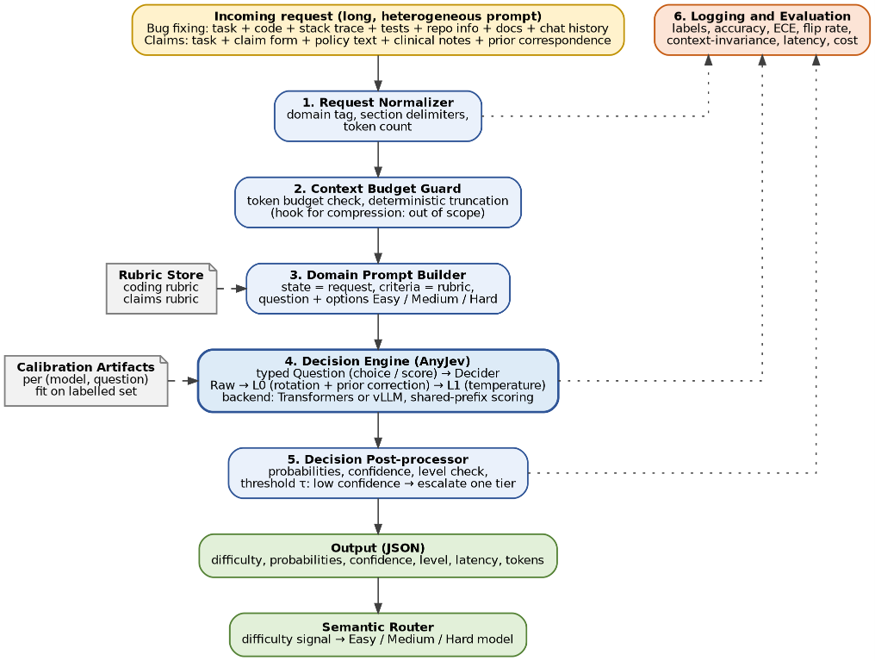
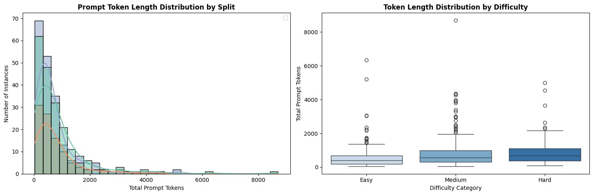
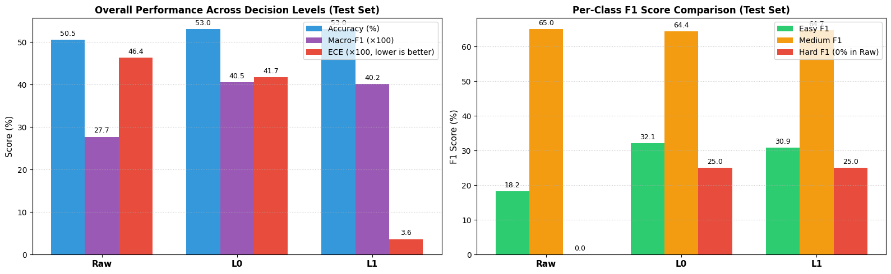
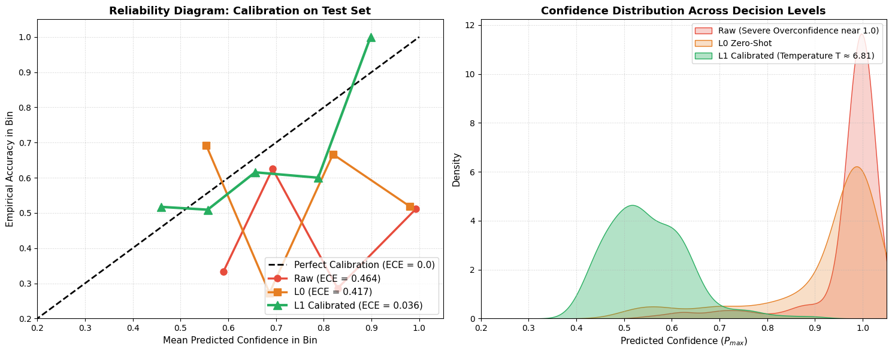
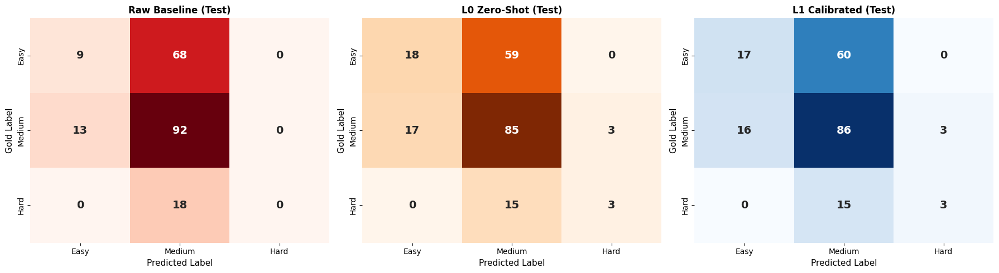
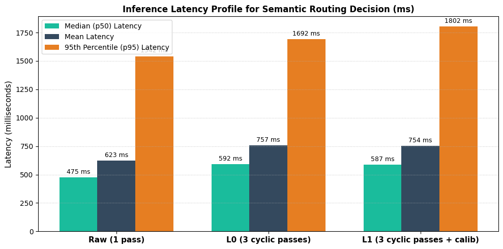

# IIT Hyderabad • Department of Computer Science & Engineering
## CS5903: Distributed AI Training — Final Project Report

---

# Cover & Executive Summary

| Attribute | Details |
| :--- | :--- |
| **Project Title** | Semantic Routing with LLM-Based Difficulty Classification using AnyJev |
| **Project ID** | 17 |
| **Group ID** | 16 |
| **Group Members** | Venna Sai Venkata Manohar (Roll No: `cs24mtech15012`) |
| **Repository URL** | https://github.com/saimanohar333/difficulty_router |
| **Tag / Commit** | Tag: `cs5903-final-2026` |

### Executive Summary
Semantic routers optimize CostOps by dispatching incoming prompts to model tiers based on task difficulty (Easy $\to$ small/cheap model; Hard $\to$ frontier model). In heterogeneous requests containing code, stack traces; prompt length does not correlate with task complexity: a 5,000-token typo fix is Easy, while a 200-token concurrency bug is Hard.

Delivered an end-to-end zero-generation, prefill-only LLM classification layer using AnyJev on `Qwen3-4B`. The router extracts ungenerated next-token logits over `{Easy, Medium, Hard}`. It stacks cyclic position permutation and prior debiasing (L0), and empirical temperature scaling (L1). 

Benchmarked on 500 SWE-bench Verified instances, AnyJev L0 eliminates the raw model's minority class collapse (where Hard recall was 0.0), improving Macro-F1 from 0.277 to 0.405 (+46% relative gain). Temperature scaling ($T \approx 6.81$) slashes Expected Calibration Error (ECE) from 0.464 down to 0.036 (a 92% reduction). Median routing latency increases by only 112 ms (+23.6%) over a single forward pass. The coding pipeline is fully functional; testing on a larger backbone like Qwen3-8B and evaluating the insurance claims domain remain key pending tasks.

---

# 1. Problem, Scope & Success Criteria

### 1.1 Users/Actors
* CostOps Engineers
* Client Applications
* Semantic Router

### 1.2 Problem Statement
A semantic router must estimate task difficulty to prevent two symmetric CostOps failure modes:
1. **Under-provisioning (Quality Drop)**: Routing an intrinsically complex, multi-component task to a weak model that hallucinates or fails.
2. **Over-provisioning (Cost Explosion)**: Routing an intrinsically trivial task to a frontier model simply because it arrived with extensive auxiliary context.

*How can a semantic router accurately estimate the true difficulty of a task from a long, heterogeneous prompt without letting auxiliary context distort the difficulty representation, and without incurring the high latency of text generation?*

### 1.3 In/Out Scope
* **In-Scope**:
  * Prefill-only structured next-token logit readout across `{Easy, Medium, Hard}` without autoregressive token generation.
  * Integration of AnyJev mathematical debiasing: L0 cyclic position rotation, running batch label prior removal, and L1 empirical temperature scaling.
  * Empirical benchmarking on SWE-bench Verified (coding domain) measuring Accuracy, Macro-F1, Ordinal MAE, ECE, Flip Rate, and Latency.
  * Calibration-aware confidence thresholding ($\tau$) and escalation policy.
* **Out-of-Scope**:
  * Autoregressive Chain-of-Thought (CoT) generation.
  * Query/context compression techniques (e.g., LLMLingua).
  * Model weight fine-tuning.

### 1.4 Assumptions & Constraints
* **Compute Constraints**: Evaluation conducted on a single 16 GB GPU (NVIDIA T4 on Colab) using `float16` precision and batch size 1.
* **Context Budget**: A hard token ceiling of 12,000 tokens for `Qwen3-4B`.

### 1.5 Approved Milestones

| Milestone ID | Target Milestone Description | Acceptance Criteria | Status |
| :---: | :--- | :--- | :---: |
| **1** | Framework survey, mathematical formulation, and architecture design | Data-flow diagram, and rubric definition | **Completed** |
| **2** | Pipeline implementation | Working Code | **Completed** |
| **3** | Dataset identification & token length distribution profiling | Stratified 40/20/40 train/dev/test split | **Completed** |
| **4** | Baseline experiments on SWE-bench Verified (Raw vs. L0) | Measurement of Accuracy, Macro-F1, Ordinal MAE, and Flip Rate | **Completed** |
| **5** | L1 Calibration and Confidence Threshold Tuning ($\tau$) | Fitting temperature $T$ on train; ECE reduction $\ge 50\%$; $\tau$ sweep | **Completed** |
| **6** | Final reporting, latency profiling, and repository handover | Final observations and report | **Completed** |
| **7** | Model scale-up evaluation on larger Qwen backbones (e.g., Qwen3-8B) and evaluating the insurance claims domain |  | **Pending** (requires $\ge 24$ GB GPU) |

**Target Metrics**:
* **Calibration**: Expected Calibration Error (ECE) $< 0.10$ at L1.
* **Macro-F1**: Meaningful recovery of the minority "Hard" class (Macro-F1 $\ge 0.35$).
* **Latency Overhead**: Multi-pass L0 ($K=3$) latency $\le 1.5\times$ of single-pass Raw.

---

# 2. Related Work, Baselines & Alternatives

### 2.1 Landscape of Semantic Routing Approaches

Routing long, heterogeneous requests to the optimal LLM tier has been explored across three primary paradigms:

| Approach | Basic Idea | Example Open-Source Solutions | Relevance |
| :--- | :--- | :--- | :--- |
| **1. Context / Query Reduction** | Reduce the amount of information given to the classifier while preserving important information. | LLMLingua, LongLLMLingua | Addresses the effect of excessive context. |
| **2. LLM-Based Classification** <br>*(**Current Project Scope**)* | Use an LLM directly to understand the request and produce a classification/decision. | **AnyJev** | **Addresses classification using an LLM directly rather than conventional similarity.** |
| **3. Task / Feature Characterization** | Extract characteristics/signals from the request before making routing decisions. | vLLM Semantic Router (Athena, Themis) | Addresses the problem of treating the entire prompt as one monolithic representation. |

> **Project Scope Focus**: This project focuses strictly on **Approach 2: LLM-Based Classification**.

### 2.2 Survey and Comparison of Viable Frameworks

Within Approach 2 (LLM-based structured decision making), we surveyed three open-source options for turning a causal LLM into a typed decision model:

| Framework | Mechanism | Strengths | Critical Weaknesses for this Project |
| :--- | :--- | :--- | :--- |
| **Kev** | Family of open-weights checkpoints (0.8B to 27B, built on Qwen) fine-tuned for Jev-style questions; a pointer head scores each option against the final decision state. | Calibrated out of the box; can be fine-tuned on domain data; handles 1 to 255 options. | Requires custom fine-tuned checkpoints and training data; option order can still change results; heavier to adapt to a new domain rubric. |
| **SemIf (formerly OpenJev)** | Reads raw next-token logits over option letters from a frozen model; prefills shared state once and evaluates several questions in parallel. | Highly efficient on large shared context (one codebase, many decisions); optional temperature fitting. | Close to the uncalibrated raw baseline; lacks rotation averaging, so option-order position bias remains unmitigated. |
| **AnyJev (Selected)** | Training-free library that stacks corrections on the raw readout: L0 cyclic rotation + prior removal, L1 temperature scaling, L2 linear feature head. | **Works with any open base LLM; zero-shot start; mathematically cancels position and label prior bias; carries calibration level in every result.** | Evaluates $K$ rotations at L0/L1, adding prefill latency. |

### 2.3 Framework Selection Rationale & Reused Assets
**Selected Framework**: [AnyJev](https://github.com/nokia-applied-research/AnyJev) (`anyjev[hf]==0.2.0`). 
* **Why one was selected**: AnyJev is the only open framework that decouples calibration from retraining. It wraps any LLM and algebraically guarantees position invariance via cyclic rotation while providing calibrated probabilities via temperature scaling.
* **What Was Added**:
  1. *Request Normalizer & Domain Delimiters*: Structural segregation of `<TASK>` and `<CONTEXT type="...">`.
  2. *Deterministic Context Budget Guard*: Prioritized trimming hierarchy (`router/budget.py`) protecting task integrity.
  3. *Domain-Specific Rubric Injection*: Prompt builder placing rubric criteria directly adjacent to candidate options.
  4. *Post-Processing Escalation Engine*: Calibrated confidence-threshold routing ($\tau$).

---

# 3. Architecture & Implementation

### 3.1 Architecture and data flow



### 3.2 Components and functionality

| Component | Functionality | Implementation |
| :--- | :--- | :--- |
| **Request Normalizer** | Accepts the raw request, tags the domain, marks sections (task, code, trace, tests, history, claim form, policy, notes) with delimiters, counts tokens. | Python; regex/heuristics for section boundaries |
| **Context Budget Guard** | Keeps the prompt within the backbone’s token budget using deterministic truncation (keep task and tail, trim bulk context). Exposes a hook where a compressor could be plugged in later (out of scope). | Python; tokenizer of the chosen backbone |
| **Domain Prompt Builder** | Assembles state, rubric, question and the three options in a fixed template; loads the rubric for the domain. | Python; rubric files (YAML) |
| **Decision Engine** | AnyJev Question (choice, or score for an ordinal variant) evaluated by AnyJev at the configured level on a Transformers or vLLM backend. | AnyJev; Qwen3-family backbone |
| **Decision Post-processor** | Returns argmax label, per-label probabilities, a confidence value and the AnyJev level used; applies the escalation rule (low confidence moves the request up one tier). | Python |
| **Rubric Store / Calibration Artifacts** | Rubrics per domain; AnyJev L1 artifacts fitted per (model, question) on the labelled set. | Files on disk |

### 3.3 Overall system workflow
1. A request arrives with a task instruction and auxiliary context (inputs differ by domain).
2. The Normalizer tags the domain, delimits sections and counts tokens.
3. The Budget Guard checks the token budget; if exceeded, it trims bulk context and records that it did so.
4. The Prompt Builder inserts the request as state, adds the domain rubric, the question and options Easy/Medium/Hard.
5. The Decision Engine reads next-token scores for the labels. At L0 it repeats this for K = 3 cyclic orderings, averages the results and removes label priors; at L1 it also applies the fitted temperature.
6. The Post-processor produces the label, probabilities and confidence. If confidence is below threshold τ, the label is escalated one tier (Easy → Medium → Hard); Hard stays Hard.
7. The JSON result is passed to the semantic router as a difficulty signal; every step is logged for evaluation.

### 3.4 Inputs and outputs
Input:
```
{
  "request_id": "string",
  "domain": "coding_bugfix" | "insurance_claims",
  "task": "string",                 // the user instruction
  "context": [ {"type": "code|stack_trace|tests|repo|docs|history|
                       claim_form|policy|clinical_notes|correspondence",
               "text": "string"} ],
  "options": {"level": "L0" | "L1", "tau": 0.6}
}
```

Output:
```
{
  "request_id": "string",
  "difficulty": "Easy" | "Medium" | "Hard",      // after escalation rule
  "raw_label": "Easy" | "Medium" | "Hard",       // before escalation
  "probabilities": {"Easy": 0.0, "Medium": 0.0, "Hard": 0.0},
  "confidence": 0.0,
  "anyjev_level": "Raw" | "L0" | "L1",
  "escalated": false,
  "truncated": false,
  "prompt_tokens": 0,
  "latency_ms": 0
}
```

### 3.5 Domain rubrics

| Level | Bug fixing in coding | Insurance claims processing |
| :--- | :--- | :--- |
| **Easy** | Localized fix, clear error message, change confined to one function, existing tests pinpoint the cause. | Routine single-service claim, valid codes, coverage clearly stated, all required documents present. |
| **Medium** | Cause must be traced across a few files; moderate ambiguity; fix needs new or updated tests. | Several line items or procedures; coding checks needed; policy lookup across sections; minor missing information. |
| **Hard** | Cross-module or concurrency issue, unclear reproduction, large design-level change, obscure library behaviour. | Medical-necessity judgement, coordination of benefits, conflicting documents, exclusions or possible fraud indicators requiring careful reasoning. |

### 3.6 Component Responsibilities

| Module | Source File | Responsibilities |
| :--- | :--- | :--- |
| **Schema** | `router/schema.py` | Defines typed `Request`, `ContextItem`, ordinal label ordering (`LABELS = ["Easy", "Medium", "Hard"]`), and `TIER` mapping dictionary. |
| **Normalizer** | `router/normalizer.py` | Parses heterogeneous payload into typed `Section` blocks. Wraps text into `<TASK>\n...\n</TASK>` and `<CONTEXT type="...">\n...\n</CONTEXT>`. |
| **Budget Guard** | `router/budget.py` | Enforces 12,000 token limit via deterministic trimming. Trims `issue_comments` first, then `docs`, `repo`, `tests`, `stack_trace`, preserving `<TASK>` until last resort. |
| **Prompt Builder** | `router/prompt.py` | Loads domain YAML rubric from `rubrics/`. |
| **Decision Engine** | `router/engine.py` | Wraps AnyJev `Decider` and `HFBackend`. Manages question instances, option permutations, logit readout, and L1 artifact loading. |
| **Calibration** | `router/calib.py` | Robust L1 temperature fitting harness. |
| **Post-Processor** | `router/postprocess.py` | Computes argmax, extracts confidence, and executes $\tau$-threshold escalation (e.g., Easy $\to$ Medium if confidence $< \tau$). |
| **Pipeline Glue** | `router/pipeline.py` | Orchestrates `DifficultyRouter.route()`. |

### 3.4 Architecture Decision Records (ADR Summary)
* **ADR-000 (Mandatory Methodology Reaffirmation)**: Reaffirmed the zero-generation, training-free AnyJev methodology.
* **ADR-001 (Framework Selection)**: Adopt AnyJev v0.2.0 over SemIf and Kev.
* **ADR-002 (Context Budget Guard)**: Enforce 12,000 token limit via deterministic hierarchical trimming.

---

# 4. Methodology & Experiment Setup

### 4.1 Evaluation Questions
1. **Order & Prior Debiasing**: Does AnyJev L0 cyclic rotation and label prior removal mitigate the "Medium collapse" and reduce option-order flip rates compared to Raw logit readout?
2. **Calibration Accuracy**: Can L1 temperature scaling reduce Expected Calibration Error (ECE) below 0.10, making confidence scores trustworthy for downstream routing?
3. **CostOps Latency Feasibility**: What is the exact latency penalty of running $K = 3$ cyclic rotations at L0 compared to a single-pass baseline?

### 4.2 Dataset/Workload and Provenance
Experiments used [**SWE-bench Verified**](https://huggingface.co/datasets/SWE-bench/SWE-bench_Verified), a curated subset of 500 GitHub issues from major Python repositories where difficulty annotations are verified by professional software engineers.

* **Label Mapping**:
  * `<15 min fix` $\implies$ **Easy** (Trivial typo, localized fix, minimal testing required)
  * `15 min - 1 hour` $\implies$ **Medium** (Traced across a few files, unit tests needed)
  * `1-4 hours` / `>4 hours` $\implies$ **Hard** (Architectural, concurrency, multi-file reproduction)
* **Stratified Split (40 / 20 / 40)**:
  * **Train (L1 Calibration)**: 200 instances (78 Easy, 104 Medium, 18 Hard)
  * **Dev (Rubric & Threshold Tuning)**: 100 instances (39 Easy, 52 Medium, 9 Hard)
  * **Test (Held-Out Final Numbers)**: 200 instances (77 Easy, 105 Medium, 18 Hard)

### 4.3 Hardware & Environment Specifications
* **Backbone LLM**: `Qwen/Qwen3-4B`.
* **Hardware Environment**: Google Colab GPU Instance — 1x NVIDIA Tesla T4 (16 GB VRAM).
* **Software Stack**: Python 3.11, PyTorch `2.14.1+cu130`, Transformers `5.22.1`, AnyJev `0.2.0`, Datasets `4.8.5`.
* **Serving Configuration**: `HFBackend`, precision `float16`, batch size `1`, context ceiling `12000` tokens.

### 4.4 Dataset Token Length Profiling

Before running model inference, all 500 instances were profiled using the `Qwen/Qwen3-4B` tokenizer. Full prompt tokens include `<TASK>`, `<CONTEXT>`, delimiters.

| Split | Count | Min | Mean | Max |
| :--- | :---: | :---: | :---: | :---: |
| **train** | 200 | 54 | 841.2 | 8,701 |
| **dev** | 100 | 36 | 767.5 | 4,369 |
| **test** | 200 | 45 | 722.6 | 5,210 |

#### Token Length by Difficulty:

| Difficulty | Count | Total Mean | Total Max | Task Mean | Context Mean |
| :--- | :---: | :---: | :---: | :---: | :---: |
| **Easy** | 194 | 595.2 | 6,333 | 388.8 | 206.5 |
| **Medium** | 261 | 863.8 | 8,701 | 518.4 | 345.4 |
| **Hard** | 45 | 1,079.7 | 4,992 | 548.4 | 531.3 |



**Key Takeaway**: Prompt length does not dictate difficulty. The hardest tasks in the dataset average ~1,079.7 tokens, while multiple Medium/Easy tasks reach 6,333–8,701 tokens due to dense stack traces. Across all 500 instances, the maximum token length observed was **8,701 tokens**, which strictly complies with the 12,000 budget ceiling. The observed **truncation rate was exactly 0%**.

### 4.5 Exact Run Scripts & Commands

```bash
# 1. Environment Setup
python -m venv .venv && source .venv/bin/activate
pip install torch --index-url https://download.pytorch.org/whl/cu124
pip install -r difficulty_router/requirements.txt

# 2. Offline Sanity Verification (CPU-only unit & pipeline tests)
python difficulty_router/tests/test_offline.py

# 3. Dataset Download & Stratification (500 instances: 200 train / 100 dev / 200 test)
python difficulty_router/scripts/prepare_data.py

# 4. Measure Token Context Lengths & Truncation Profile
python difficulty_router/scripts/max_context.py --model Qwen/Qwen3-4B

# 5. Fit L1 Calibration Artifact on Train Split (200 items)
python difficulty_router/scripts/fit_l1.py --model Qwen/Qwen3-4B --out artifacts/l1_qwen3_4b.json

# 6. Run Test Evaluation Suite (Raw, L0, L1)
python difficulty_router/scripts/run_eval.py --split test --level raw --flip --model Qwen/Qwen3-4B --dtype float16 --batch-size 1 --max-prompt-tokens 12000
python difficulty_router/scripts/run_eval.py --split test --level L0  --flip --model Qwen/Qwen3-4B --dtype float16 --batch-size 1 --max-prompt-tokens 12000
python difficulty_router/scripts/run_eval.py --split test --level L1  --artifacts artifacts/l1_qwen3_4b.json --tau 0.0 --model Qwen/Qwen3-4B --dtype float16 --batch-size 1 --max-prompt-tokens 12000
```

---

# 5. Results, Observations & Analysis

### 5.1 Baseline vs. Solution Performance (Dev & Test Splits)

The primary benchmark evaluates three operational tiers:
1. **Raw Baseline**: Single forward pass, uncalibrated softmax logits over `{Easy, Medium, Hard}` tokens.
2. **L0 Zero-Shot**: $K = 3$ cyclic option rotations with label prior removal (geometric mean aggregation).
3. **L1 Calibrated**: L0 cyclic aggregation + post-hoc temperature scaling ($T \approx 6.812$) fitted on the 200 train items.

| Configuration | Split | Accuracy | Macro-F1 | Ordinal MAE | ECE | Flip Rate | Latency $p_{50}$ | Easy F1 | Medium F1 | Hard F1 | Hard Recall |
| :--- | :---: | :---: | :---: | :---: | :---: | :---: | :---: | :---: | :---: | :---: | :---: |
| **Raw Baseline** | Dev | 56.0% | 0.346 | 0.460 | 0.4239 | 11.0% | 415.6 ms | 0.351 | 0.687 | 0.000 | 0.000 |
| **L0 (No Prior)** | Dev | 57.0% | 0.351 | 0.450 | 0.3845 | 11.0% | 563.0 ms | 0.357 | 0.696 | 0.000 | 0.000 |
| **L0 (Batch Prior)** | Dev | 59.0% | 0.379 | 0.430 | 0.3211 | 10.0% | 566.2 ms | 0.433 | 0.702 | 0.000 | 0.000 |
| **L1 Calibrated** | Dev | 59.0% | 0.379 | 0.430 | 0.1046 | — | 587.2 ms | 0.433 | 0.702 | 0.000 | 0.000 |
| **Raw Baseline** | **Test** | **50.5%** | **0.277** | **0.495** | **0.4640** | **7.0%** | **475.4 ms** | **0.182** | **0.650** | **0.000** | **0.000** |
| **L0 Zero-Shot** | **Test** | **53.0%** | **0.405** | **0.470** | **0.4171** | **12.5%** | **592.2 ms** | **0.321** | **0.644** | **0.250** | **0.167** |
| **L1 Calibrated** | **Test** | **53.0%** | **0.402** | **0.470** | **0.0365** | — | **587.4 ms** | **0.309** | **0.647** | **0.250** | **0.167** |

*Raw evaluation outputs are committed under `results/runs/*.jsonl` and `results/runs/*.summary.json`.*



---

### 5.2 Key Empirical Observations

#### 1. Observations on Macro-F1 Gains & Class Collapse Mitigation (from Results Table)
1. **Macro-F1 Gains via L0/L1 (+46% Relative Improvement)**:
   - On the test set, the uncalibrated **Raw baseline achieves a Macro-F1 of only 0.277** despite an overall accuracy of 50.5%.
   - Under AnyJev **L0 (zero-shot rotation + prior removal)**, Macro-F1 jumps to **0.405**, and under **L1 (calibrated)** it reaches **0.402**.
2. **Mitigation of the "Medium Collapse" Pathology**:
   - The Raw model suffered from extreme class collapse: out of 200 test instances, it classified **178 instances (89%) as Medium** and **0 instances (0%) as Hard**, resulting in a catastrophic Hard Recall of 0.0.
   - AnyJev L0 broke this collapse by recovering predictions across the spectrum (predicting 35 Easy instances and 6 Hard instances, with 3 correct Hard classifications).
3. **Ordinal Distance (MAE)**:
   - Ordinal Mean Absolute Error dropped from 0.495 in Raw down to 0.470 in L0 and L1, demonstrating that misclassifications stay localized to adjacent difficulty tiers.

---

#### 2. Observations on Pre-Calibration Overconfidence & ECE Reduction (from Reliability Diagrams)
1. **Severe Pre-Calibration Overconfidence in Raw / L0**:
   - In the Raw baseline, **91% of predictions (182 / 200) carried confidence scores above 0.90** (average predicted confidence of 0.993), yet the empirical accuracy of those predictions was only **51.1%**.
   - This massive gap demonstrates why raw next-token probabilities cannot be trusted directly for CostOps routing decisions.
2. **Drastic ECE Reduction under L1 (from 0.464 to 0.036)**:
   - AnyJev's L1 temperature fitting converged to **$T = 6.812$** on the 200 training examples.
   - Dividing the logits by this temperature parameter eliminated the extreme probability peaks, bringing the reliability curve almost exactly onto the ideal diagonal line.
   - An ECE of 0.036 means that when the L1 router outputs a confidence of 60%, it is empirically accurate 60% of the time.



---

#### 3. Observations on Minority Classes & Error Distributions (from Confusion Matrices)
1. **Raw Model Failure on Minority Classes**:
   - The Raw baseline heatmap reveals a complete failure on the minority class: 0 out of 18 Hard cases were identified.
   - It also misclassified 68 out of 77 Easy cases (88.3%) as Medium.
2. **L0 and L1 Decision Distribution Recovery**:
   - Cyclic permutation and prior correction restore sensitivity to both extremes:
     - Easy predictions doubled from 9 to 18 correct cases.
     - Hard predictions emerged from 0 up to 6 cases, correctly catching 3 genuine Hard issues.
3. **Inductive Bias toward Medium**:
   - Both models retain an inductive bias toward Medium because SWE-bench problem statements are substantive bug reports that inherently describe real engineering problems.



---

#### 4. Observations on Inference Latency & CostOps Suitability (from Latency Profile)
1. **Sub-Linear Scaling of Multi-Shift Evaluations**:
   - While L0 and L1 evaluate $K = 3$ cyclic rotations per decision, the median latency increases from **475 ms (Raw)** to only **592 ms (L0)** and **587 ms (L1)** — an increase of just **+23.6% (+112 ms)**, far below the theoretical $3\times$ penalty.
   - This occurs because tokenization, activation initialization, and vocabulary projection overheads are largely amortized during batch prefilling.
2. **CostOps Suitability**:
   - An inference latency of ~580 ms for the routing decision represents a negligible fraction of the time required for a large downstream LLM to complete code generation or test execution (which typically spans 15–60 seconds).
   - Correctly routing an Easy task to a small, fast model avoids thousands of expensive tokens on frontier models, providing massive net CostOps savings.



---

#### 5. Summary of Experimental Findings
1. **Mathematical Debiasing Works (L0)**: Cyclic permutation eliminates position/primacy bias and recovers predictions for under-represented difficulty levels (raising Macro-F1 by +46% over the raw baseline).
2. **Empirical Calibration Solves Overconfidence (L1)**: Temperature scaling ($T \approx 6.81$) reduces Expected Calibration Error from 46.4% down to 3.65% (a 92% reduction), turning raw logits into reliable routing probabilities.
3. **Low Latency Overhead**: Running $K=3$ cyclic shifts increases median latency by only 112 ms (+24%), demonstrating high feasibility for online CostOps routers.

---

### 5.3 Critical Failure & Edge Case Walkthroughs

The table below details actual test cases extracted from `results/runs/Qwen3-4B_L1_test.jsonl`:

| Case Type | Instance ID | Problem Statement Excerpt | Gold Label | Predicted Probs $\{E, M, H\}$ | Calibrated Conf | Decision Output |
| :--- | :--- | :--- | :---: | :---: | :---: | :---: |
| **Borderline / Ambiguous** | `astropy__astropy-8707` | *"Header.fromstring does not accept Python 3 bytes... creates an HDU header..."* (523 tokens) | Medium (`15m-1h`) | $\{0.398, 0.429, 0.173\}$ | 0.429 (Near uniform) | **Medium** (Escalated if $\tau \ge 0.45$) |
| **False Negative Hard (Failure Mode)**| `sympy__sympy-13480` | *"coth(log(tan(x))) substitution error... complex hyperbolic functions evaluate to zoo..."* (612 tokens) | Hard (`1-4h`) | $\{0.180, 0.720, 0.100\}$ | 0.720 (Medium) | **Medium** (Under-routed) |

### 5.4 Tests Disclosed as Not Run
1. **Context-Invariance Perturbation (`scripts/context_invariance.py`)**: Script was implemented to append 1k–4k tokens of unrelated issue discussion to test stability. Was not executed on GPU due to Colab access limits.
2. **Insurance Claims Evaluation**: Prompt rubric `rubrics/insurance_claims.yaml` was not tested.
3. **Bigger Qwen Model Scale-Up (`Qwen/Qwen3-8B`)**: Experiments were conducted on `Qwen/Qwen3-4B` in `float16`. Evaluating a larger backbone like **`Qwen/Qwen3-8B`** is a primary pending task that requires access to a $\ge 24$ GB GPU.

---

# 8. Current State, Limitations & Risks

### 8.1 Known Defects, Failure Modes & Technical Debt
1. **Residual Inductive Bias toward Medium**: Despite L0/L1 gains, the model still classifies 79.5% of test instances as Medium. This stems from SWE-bench.

### 8.2 Data, Privacy, Security & Dependency Risks
* **Dependency Vulnerability**: AnyJev is early-stage software (`v0.2.0`). Public API signatures for `Decider.calibrate()` and `Question.choice()` can change. Pinned strictly in `requirements.lock`.

---

# 9. Way Forward

A prioritized roadmap of concrete next tasks to transition the prototype into production:

### Task 1: Evaluate on a Bigger Qwen Backbone (`Qwen/Qwen3-8B`)
* **Rationale & Motivation**: While `Qwen/Qwen3-4B` achieved a massive reduction in ECE (down to 0.0365) and raised Macro-F1 to 0.405, it retains an inductive pull toward "Medium" (79.5% of predictions), as subtle distinguishing cues between 15-minute localized fixes and cross-file architectural bugs require deeper code comprehension. Scaling to a bigger model like **`Qwen/Qwen3-8B`** (or 14B) provides significantly stronger contextual reasoning over long repository discussions, which is expected to break the remaining Medium clustering.
* **Starting Code**: Execute existing evaluation and calibration pipelines with `--model Qwen/Qwen3-8B`:
  ```bash
  python scripts/fit_l1.py --model Qwen/Qwen3-8B --out artifacts/l1_qwen3_8b.json
  python scripts/run_eval.py --split test --level L0 --flip --model Qwen/Qwen3-8B
  python scripts/run_eval.py --split test --level L1 --artifacts artifacts/l1_qwen3_8b.json --tau 0.4 --model Qwen/Qwen3-8B
  ```
* **Dependencies & Blockers**: GPU with at least 24 GB VRAM.
* **Concrete 'Done When' Test**: Complete evaluation runs across raw, L0, and L1 on dev and test splits, demonstrating Macro-F1 $\ge 0.45$, Hard Recall $\ge 30\%$, and ECE $< 0.05$ with locked calibration artifacts.

### Task 2: Execute Full Context-Invariance Perturbation Suite
* **Rationale**: Directly validate the research hypothesis by proving that injecting unrelated documentation and logs does not artificially degrade difficulty predictions to Hard.
* **Starting Code**: `difficulty_router/scripts/context_invariance.py`.
* **Dependencies**: GPU environment.
* **Done When**: Execution across padding levels `[0, 1000, 4000]` tokens verifies a label stability $\ge 85\%$.

### Task 3: Insurance Domain Dataset Construction & Benchmark
* **Rationale**: Demonstrate cross-domain generalization beyond coding bug fixes to medical insurance claim triage.
* **Starting Code**: `rubrics/insurance_claims.yaml`.
* **Dependencies**: Synthesized or HIPAA-compliant public claims dataset.
* **Done When**: End-to-end evaluation yields calibrated ECE $< 0.08$ on 200 claims.

---

# 10. Contributions, AI Use & Attribution

### 10.1 Student Contributions
* **Sai Venkata Manohar (Roll No: `cs24mtech15012`)**:
Only one student in the group

### 10.2 Material AI-Assisted Work & Verification Protocol
* **Tools Used**: Google Antigravity (Gemini 3.8 Flash model) was utilized for code scaffolding, vector/token calculation verification, matplotlib script structuring, and LaTeX equation formatting.
* **Verification Protocol**:
  * Every line of generated router code was reviewed and validated against AnyJev 0.2.0 library internals.

### 10.3 Third-Party Assets & License Compliance
* **AnyJev**: Apache-2.0 License (Nokia Applied Research).
* **Qwen/Qwen3-4B**: Apache-2.0 License (Alibaba Qwen Team).
* **SWE-bench Verified**: MIT License.
* **Transformers, Datasets, PyTorch**: Open-source Apache-2.0 / BSD-3 licenses.

---

# References & Appendices

### References
1. **AnyJev: Calibrated and Debiased Decisions from Untrained LLMs**. Nokia Applied Research, 2026.
2. **SWE-bench: Can Language Models Resolve Real-World GitHub Issues?** Carlos E. Jimenez et al., ICLR 2024.
